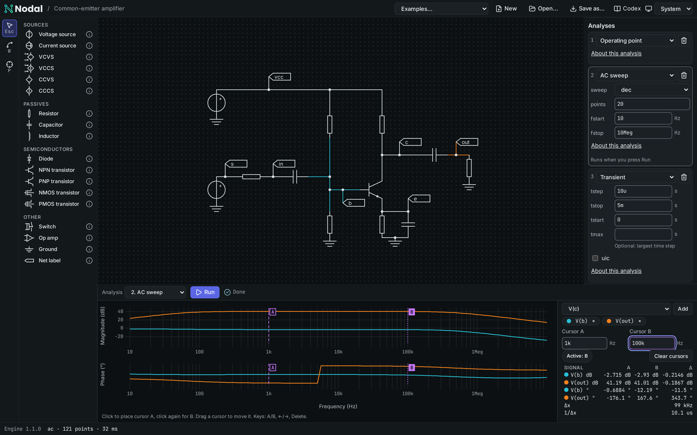
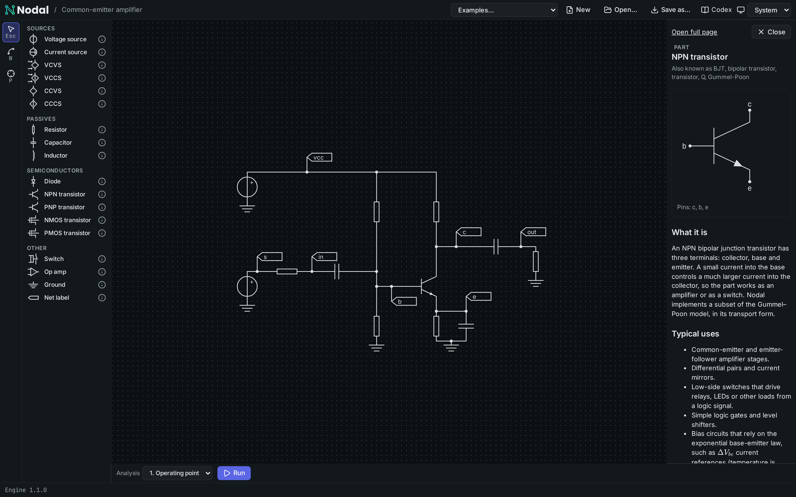
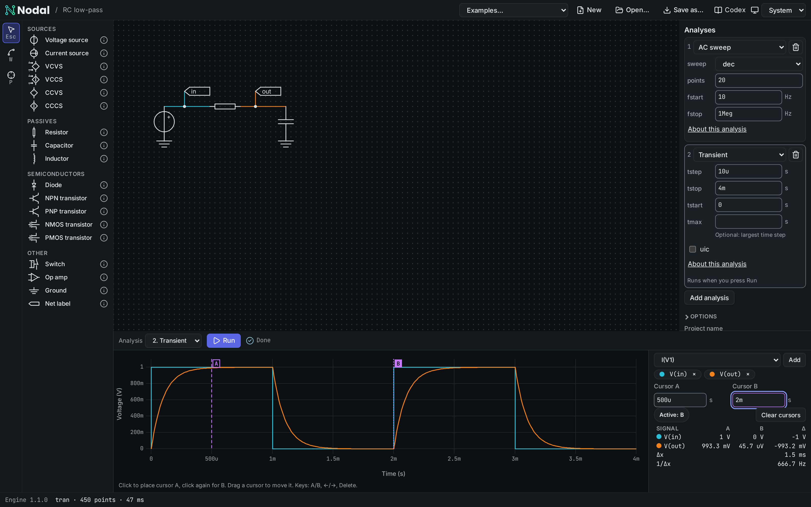
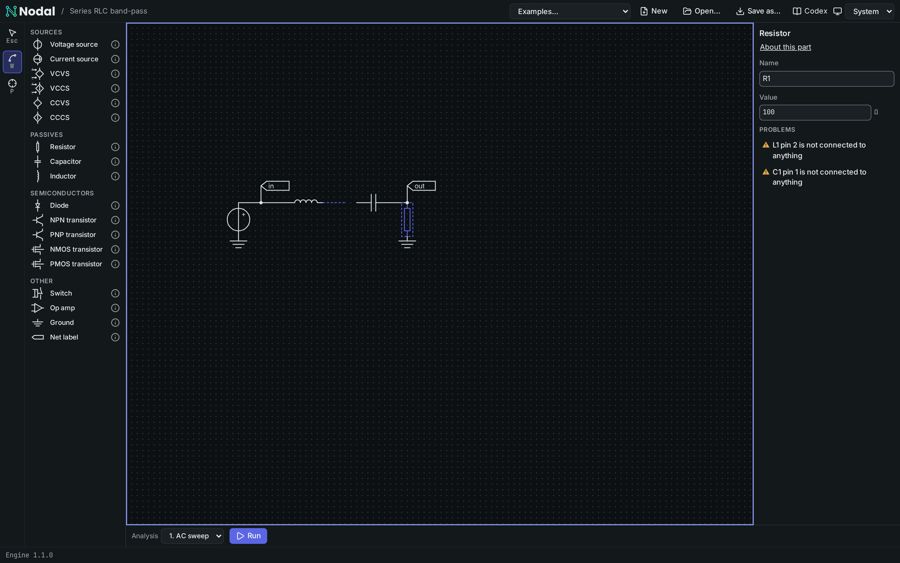

<p align="center">
<picture>
  <source media="(prefers-color-scheme: dark)" srcset="docs/brand/logo-dark.svg">
  
</picture>
</p>

<p align="center"><strong>Schematic editor and analog circuit simulator in the browser.</strong></p>

<p align="center">
  <a href="https://github.com/TristanHottier/Nodal/actions/workflows/ci.yml"></a>
  <a href="https://github.com/TristanHottier/Nodal/actions/workflows/codeql.yml"></a>
  <a href="https://github.com/TristanHottier/Nodal/releases"></a>
  <a href="LICENSE"></a>
  <a href="https://tristanhottier.github.io/Nodal/"></a>
</p>

<p align="center">

</p>

<p align="center"><a href="https://tristanhottier.github.io/Nodal/"><strong>Try it: tristanhottier.github.io/Nodal</strong></a> (no install, no account)</p>

Nodal draws a schematic and simulates it in the browser. The engine is written in Rust and runs as WebAssembly in a Web Worker. Version 1.2.0 is released.

## Features

- Draw a schematic: place parts, rotate and mirror them, draw orthogonal wires, label nets, edit values, and check the problems list. Save and load `.nodal.json` files. Work is autosaved in the browser.
- Run DC operating point, DC sweep, AC small-signal (linear, decade and octave sweeps) and transient analysis (trapezoidal and Gear integration, pulse, sine and PWL sources, `uic`, switch hysteresis). Runs can be cancelled.
- See operating-point values on the schematic. Plot results with probes, two cursors and a Bode view. Engine errors are marked on the schematic.
- Open one of twelve examples: divider, RC low-pass, RLC band-pass, half-wave rectifier, full-wave bridge rectifier, common-emitter amplifier, CMOS inverter, inverting op-amp, controlled sources, a current source into an inductor and a capacitor, a switch with hysteresis, and a push-pull emitter follower. The [user guide](docs/user-guide.md) walks through drawing and simulating.
- Read the codex: 26 entries (18 parts, 4 analyses and 4 concepts) with prose, equations, parameter tables, pin names on the symbol and a "Try it" example. Open it from the info button next to a part, from "About this part" in the inspector, or from the Codex link in the top bar. An engineer review of the equations is recorded in the [M10 plan](docs/plans/2026-11-26-m10-component-codex.md).
- Switch between light and dark themes (it follows your OS by default). The editor works from 1024 px wide; in narrower windows the schematic is shown read-only.
- Devices: R, L, C, V, I, E, G, H and F elements, an ideal op-amp, diode, BJT, MOSFET Level 1 and voltage-controlled switch, with junction and overlap capacitances in AC and transient. Sources can be DC, AC, pulse, sine or PWL.
- `nodal-cli` has three commands: `run` simulates a netlist, `export-spice` prints an ngspice deck, and `validate` compares results with the ngspice goldens in `validation/`.

Not in v1: digital logic, microcontroller emulation, accounts and sharing, PCB layout. Nothing else described in these docs exists unless [`docs/ROADMAP.md`](docs/ROADMAP.md) marks it as done.







## Quick start

### Use it online

Open https://tristanhottier.github.io/Nodal/ and pick an example from the first-run prompt or the "Examples..." menu.

### Run it locally

Prerequisites: Node 24, pnpm 12.18, a Rust toolchain (pinned in `rust-toolchain.toml`) and wasm-pack 0.15.1.

```sh
pnpm install
pnpm build:wasm
pnpm --filter @nodal/web dev
```

## Development

Run these from the repository root.

| Task | Command |
|---|---|
| Rust tests | `cargo test --workspace` |
| Validation suite | `cargo run -p nodal-cli -- validate validation` |
| WASM build | `pnpm build:wasm` |
| Web dev server | `pnpm --filter @nodal/web dev` |
| Web tests | `pnpm test` and `pnpm --filter @nodal/web e2e` |
| Lint and format | `cargo fmt --check && cargo clippy --workspace --all-targets -- -D warnings && pnpm lint && pnpm format:check` |

## How correctness is checked

Every analysis is compared against [ngspice](https://ngspice.sourceforge.io/) on a fixed suite of reference circuits, and simple circuits are also checked against closed-form solutions. CI blocks any change that breaks the suite. Accuracy claims in these docs are limited to what a passing test shows; see [`docs/VALIDATION.md`](docs/VALIDATION.md).

### Validation results

CI compares 30 golden results with ngspice-42 and all pass (CI run [45001613473](https://github.com/TristanHottier/Nodal/actions/runs/45001613473) at 9fb3ac1). "Worst err/tol" is the largest ratio of error to tolerance over the suite, so a value below 1 passes. Tolerances are in [`docs/VALIDATION.md`](docs/VALIDATION.md).

| Analysis | Circuits | Worst err/tol |
|---|---|---|
| Operating point | L1, L2, L3, L5, N2, N5 | 5.4e-9 (N2) |
| DC sweep | N1, N3 (3 sweeps), N4, N6 | 0.099 (N6) |
| AC | A1 to A6 | 1.4e-3 (A3) |
| Transient | T1 to T6, each with trapezoidal and Gear | 0.818 (T4, trapezoidal) |

L4 is checked against an analytic solution in the Rust tests. The examples are tested in `apps/web/src/examples/examples.test.ts`: each netlists cleanly, every analysis runs in the wasm engine, and one expected value each is checked. Each of those values was compared once with ngspice-42 (worst relative difference 3e-6). The common-emitter example uses tight solver options; at default tolerances its AC gain differs from ngspice by 2.6 %, which is an open item.

### Performance budget

Measured by `pnpm --filter @nodal/web e2e:perf`, which opens `bench.html` in headless Chromium on GitHub Actions `ubuntu-latest` with optimized WASM (CI run [45278492943](https://github.com/TristanHottier/Nodal/actions/runs/45278492943) at 951bdb6).

| Case | Budget | Measured |
|---|---|---|
| Transient, 50 nodes, at least 10,000 accepted points | < 1 s | 732.0 ms (median of 5) |
| AC sweep, 50 nodes, 1,001 frequencies | < 200 ms | 78.9 ms (median) |
| Editor pan and zoom, 500 parts | 60 fps | 59.5 fps (pan 60.0, zoom 59.0), 2 slow frames (> 25 ms) of 240 |
| WASM module, gzipped | < 1 MB | 246,485 bytes |

The test passes with a mean of at least 58 fps and at most 5 % slow frames, to allow for timer jitter. On Tristan's laptop in desktop Chrome (2026-11-22, deployed app at 93c38f1) the same page gave a transient median of 599.6 ms (samples 572.6 to 860.3 ms), an AC median of 82.1 ms, and 60.3 fps for pan and zoom with 7 slow frames of 240. Anyone can run it at https://tristanhottier.github.io/Nodal/bench.html.

### Page load

Lighthouse lab runs against https://tristanhottier.github.io/Nodal/ in the `lighthouse` CI job (median of 3 runs, CI run [45278492943](https://github.com/TristanHottier/Nodal/actions/runs/45278492943) at 951bdb6). The limits are LCP 2.5 s, CLS 0.1 and TBT 200 ms.

| Profile | LCP | CLS | TBT |
|---|---|---|---|
| Mobile | 784 ms | 0.000 | 139 ms |
| Desktop | 249 ms | 0.000 | 0 ms |

Lighthouse varies between runners. In CI run [45284350475](https://github.com/TristanHottier/Nodal/actions/runs/45284350475) at 2e82370 the first attempt measured a mobile TBT of 235 ms, over the limit; the re-run of the job measured 61 ms.

In the same run, `e2e:perf` measured editor pan and zoom with 500 parts at 59.5 fps with 2 slow frames of 240 (limit 12). The CI job also runs axe-core (WCAG 2.2 AA) on the editor, inspector, analysis panel and waveform viewer in both themes; it finds no violations.

## Stack

| Part | Choice |
|---|---|
| Engine | Rust library crate, compiled to WASM, run in a Web Worker; native CLI for tests |
| Frontend | Vite, React, TypeScript, Zustand, SVG editor, uPlot |
| Storage | IndexedDB in the browser; JSON files for import/export |
| Hosting | Static site on GitHub Pages |
| Validation | ngspice golden files, analytic checks, Jacobian finite-difference tests |

## Documentation

| Document | Contents |
|---|---|
| [`docs/user-guide.md`](docs/user-guide.md) | How to draw, simulate and read results in the app |
| [`docs/ARCHITECTURE.md`](docs/ARCHITECTURE.md) | Repo layout, data flow, engine design, file formats |
| [`docs/ROADMAP.md`](docs/ROADMAP.md) | Milestones with exit criteria and current status |
| [`docs/VALIDATION.md`](docs/VALIDATION.md) | Reference circuits, tolerances, how goldens are made |
| [`docs/adr/`](docs/adr/) | Architecture decision records |
| [`docs/reference/`](docs/reference/) | MNA stamps, device equations, numerical methods |
| [`AGENTS.md`](AGENTS.md) | Rules for anyone (human or AI) writing code here |
| [`CONTRIBUTING.md`](CONTRIBUTING.md) | How to report bugs, propose features and send changes |

## Roadmap

Milestones M0 to M9 are done. [`docs/ROADMAP.md`](docs/ROADMAP.md) lists each exit criterion with its evidence, and the ideas for after v1 (none is a commitment).

## Contributing

Bug reports, feature ideas and small pull requests are welcome. Read [`CONTRIBUTING.md`](CONTRIBUTING.md) first, and follow the [Code of Conduct](CODE_OF_CONDUCT.md).

## Security

Report vulnerabilities privately, as described in [`SECURITY.md`](SECURITY.md).

## Changelog

Release notes are in [`CHANGELOG.md`](CHANGELOG.md).

## Citation

If you use Nodal in academic work, cite it with the metadata in [`CITATION.cff`](CITATION.cff). GitHub shows a "Cite this repository" button from that file.

## Credits

| Asset | Source | Licence |
| --- | --- | --- |
| Inter (UI font, self-hosted Latin and Greek subsets) | [Inter](https://rsms.me/inter/) via `@fontsource-variable/inter` | SIL Open Font License 1.1 |
| JetBrains Mono (numbers and code, self-hosted Latin and Greek subsets) | [JetBrains Mono](https://www.jetbrains.com/lp/mono/) via `@fontsource-variable/jetbrains-mono` | SIL Open Font License 1.1 |
| Lucide (UI icons) | [`lucide-react`](https://lucide.dev/) | ISC |
| KaTeX 0.19.1 (equations in the codex; CSS and fonts shipped) | [KaTeX](https://katex.org/) | MIT |
| marked 18.2.1 (codex Markdown, rendered at build time only) | [marked](https://marked.js.org/) | MIT |
| Poppins (outlined in the wordmark) | [Poppins](https://fonts.google.com/specimen/Poppins) | SIL Open Font License 1.1 |

Details and copyright lines are in [`docs/brand/CREDITS.md`](docs/brand/CREDITS.md).

## License

[MIT](LICENSE) © 2026 Tristan Hottier
