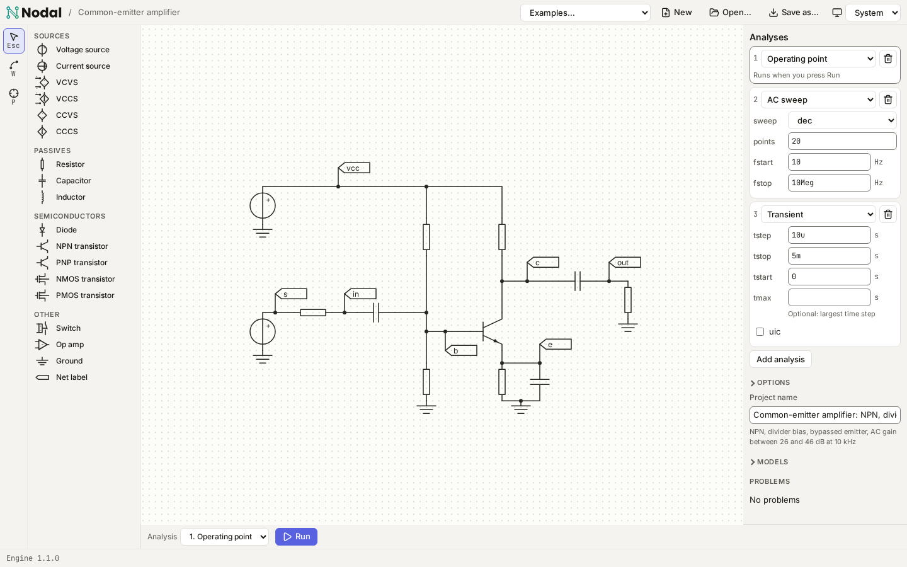
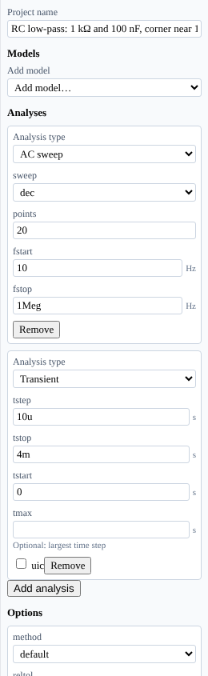
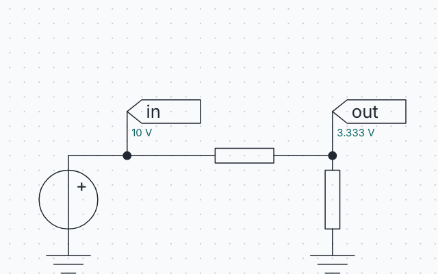
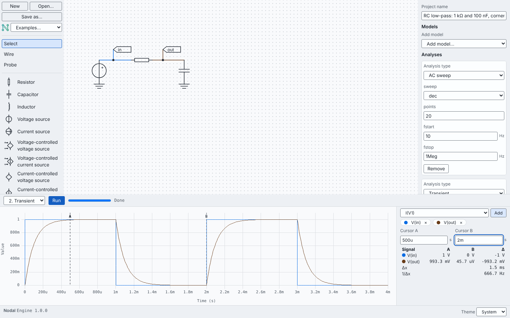
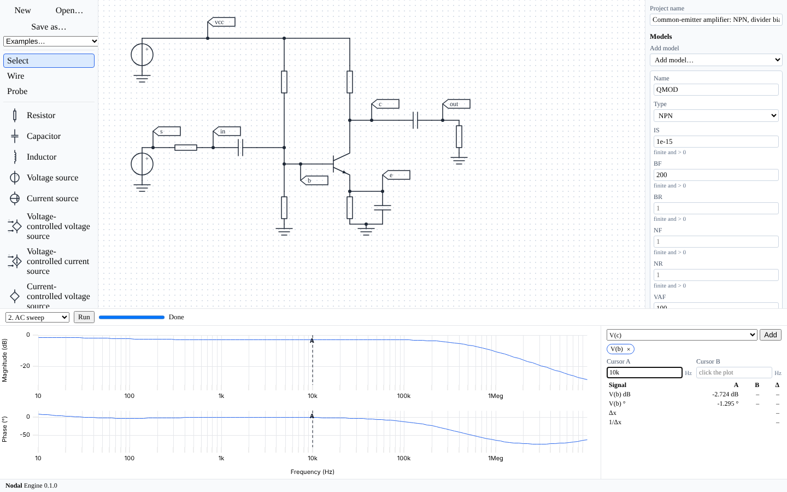

# Nodal user guide

Nodal is a schematic editor and circuit simulator that runs in your browser. This guide covers drawing a circuit, entering values, setting up an analysis, reading the results and saving your work. The screenshots come from the bundled examples.

## Getting started

Open the live editor at https://tristanhottier.github.io/Nodal/. Nothing is installed and no account is needed. The status bar at the bottom shows the engine version once the simulation engine has loaded.

The fastest way to see the app work is an example. The project bar at the top of the left column has an "Examples…" menu (labelled "Open example" for screen readers). Pick "Common-emitter amplifier" to load the circuit below. The menu has eight examples: a resistive divider, an RC low-pass, an RLC band-pass, half-wave and full-wave rectifiers, a common-emitter amplifier, a CMOS inverter and an inverting op-amp amplifier.

The window has four areas. The left column holds the project bar, the tools and the parts. The canvas is in the middle. The inspector is on the right. The run bar and results sit under the canvas, and the status bar is at the bottom.

### Theme and window size

The Theme select in the status bar has System, Light and Dark. System follows your operating system and is the default. Your choice is stored in this browser.

The editor works in windows from 1024 px wide up, and the side columns get narrower between 1024 and 1280 px. In a window narrower than 1024 px, Nodal shows the schematic read-only: you can pan and zoom, and a notice says "Nodal's editor needs a window at least 1024 px wide. The schematic is shown read-only." Widen the window to edit again.

To simulate an example, choose an analysis in the run bar (the menu left of the Run button) and press Run.

## Drawing

Choose a part in the left column, then click on the canvas to place it. The part follows the pointer snapped to the grid, and you can keep clicking to place more copies. The palette has these items:

- Resistor, Capacitor, Inductor
- Voltage source, Current source
- Voltage-controlled voltage source, Voltage-controlled current source, Current-controlled voltage source, Current-controlled current source
- Diode, NPN transistor, PNP transistor, NMOS transistor, PMOS transistor
- Voltage-controlled switch, Operational amplifier
- Ground, Net label

Every circuit needs at least one Ground. Without it the Problems list reports "The schematic has no ground symbol".

Keyboard shortcuts work on the canvas and are ignored while you type in a field:

| Key | Action |
|---|---|
| `R` | Rotate the part being placed, or the selection, by 90 degrees |
| `X` | Mirror the part being placed, or the selection (it does nothing to a net label) |
| `W` | Wire tool |
| `P` | Probe tool |
| `Right` or `Down`, `Left` or `Up` | With the canvas focused and the Select tool active, select the next or previous item (parts, then wires, then net labels, in the order you drew them) |
| `Esc` | Cancel the wire in progress, then return to the Select tool, then clear the selection |
| `Delete` or `Backspace` | Delete the selection (Select tool) |
| `Ctrl+Z`, `Ctrl+Shift+Z` or `Ctrl+Y` | Undo, redo (`Cmd` on macOS) |
| `Ctrl+C`, `Ctrl+V` | Copy, paste (`Cmd` on macOS) |

The Select tool is the default. Click a part to select it, Shift+click to add or remove items from the selection, and drag on empty canvas to box-select. Drag a selected item to move it. A selected wire is drawn heavier and in a halo, and a selected part or net label gets a dashed outline, so selection never depends on colour alone. With the canvas focused you can also select with the arrow keys (see the table), then rotate, mirror, copy or delete the item and edit it in the inspector. `Tab` always moves focus out of the canvas. The mouse wheel zooms around the pointer. Pan with a middle-button drag, or hold `Space` and drag.

### Wires

Press `W` or choose Wire. A wire starts wherever you click, so click a pin to start from it, then click to fix each corner. The preview between clicks is an L shape that runs horizontally first. Press `/` to switch it to vertical first. The wire ends when you click a pin, a net label anchor, the end of another wire or a point on another wire. You can also end it with Enter or a double click, which keeps the points you have clicked so far. `Esc` discards a wire in progress.

A wire is one conductor. Bends and crossings are not connections. Two wires join only where one ends on the other or on a pin.

### Labels

A net label names a net. Place one with the "Net label" item and edit its text in the inspector. Labels with the same text join their nets, ignoring upper and lower case, so two labelled wires connect without a wire between them. Label text may use letters, digits and underscore. `0` and `gnd` are not allowed, because ground is drawn with the Ground symbol. Labels become the signal names in the results, such as `V(out)`.

### Part names

Each part has a name that starts with its kind letter: R for a resistor, C for a capacitor, L, V, I, D, Q, M (both MOSFETs) and S, and E, G, H and F for the four controlled sources. The Name field in the inspector shows the rule if you break it. Op-amp names may use any letters, digits and underscore. Names that are equal ignoring case count as duplicates.

## Values and units

Select a part to edit its fields in the inspector. A value commits when you leave the field or press Enter. A field with a problem gets a red border and a short message.

Values accept SPICE-style suffixes. The suffixes are case-sensitive:

| Suffix | Factor | Example |
|---|---|---|
| `f` | 1e-15 | `10f` |
| `p` | 1e-12 | `47p` |
| `n` | 1e-9 | `100n` |
| `u` or `µ` | 1e-6 | `4.7u` |
| `m` | 1e-3 | `10m` |
| `k` | 1e3 | `4.7k` |
| `M`, `meg` or `Meg` | 1e6 | `1Meg` |
| `G` | 1e9 | `2.2G` |
| `T` | 1e12 | `1T` |

Plain numbers and exponents also work: `1e-9`, `0.5`, `-3.3`. Write the suffix directly after the number, with no unit and no space. `10kΩ` and `4,7k` are rejected.

The case matters in one place. `m` is milli and `M` is mega, so `1m` is 0.001 and `1M` is 1,000,000. Real SPICE reads `M` as milli. If you copy a value from a SPICE netlist, convert it first. The reason is recorded in [ADR 0009](adr/0009-value-notation.md). Results are shown with the same suffixes, with the unit attached, for example `632.1 mV`.

### Sources

Voltage and current sources have a DC value, an optional AC magnitude and phase (used by the AC sweep) and a Waveform choice: none, pulse, sin or pwl. The fields shown depend on the waveform.

- pulse: Initial value, Pulsed value, Delay, Rise time, Fall time, Pulse width and Period.
- sin: Offset, Amplitude, Frequency, Delay, Damping and Phase.
- pwl: a list of "time value" pairs separated by `;` or new lines, for example `0 0; 1m 5`.

A source with no waveform holds its DC value during a transient run.

### Capacitors and inductors

Both have a Value and an optional Initial condition (volts for a capacitor, amps for an inductor). The initial condition is used only when a transient analysis has `uic` switched on.

### Controlled sources

The four controlled sources have a Gain. The current-controlled ones also have a "Controlling source" menu that lists the voltage sources in the schematic. Renaming a voltage source does not update the controlled sources that refer to it, so choose it again after a rename. An op-amp is an ideal voltage amplifier with a Gain field. The inverting-amplifier example sets it to 1e9.

## Models

Diodes, transistors and the switch take their parameters from a model. Models belong to the project, and you manage them in the inspector when nothing is selected (click empty canvas). Use "Add model…" and pick a type: D, NPN, PNP, NMOS, PMOS or SW. Each model card has a name (letters, digits and underscore, starting with a letter), a type and one field per supported parameter. An empty field uses the default, which is shown in grey. The hint under each field gives its allowed range.

A part picks its model in its own Model menu. "New model…" in that menu creates a model of the right type and assigns it in one step.

Supported parameters:

| Type | Parameters |
|---|---|
| D | IS, N, RS, CJO, VJ, M, FC, TT |
| NPN, PNP | IS, BF, BR, NF, NR, VAF, CJE, VJE, MJE, CJC, VJC, MJC, TF, TR, FC |
| NMOS, PMOS | VTO, KP, GAMMA, PHI, LAMBDA, CGSO, CGDO, CGBO, IS |
| SW | VT, VH, RON, ROFF |

MOSFETs also take Width and Length on the part itself. Names and defaults follow ngspice. The equations are in [reference/devices.md](reference/devices.md). Anything not in the table, such as breakdown voltage on a diode or `TOX` on a MOSFET, is not supported. A project file edited by hand to include an unsupported parameter is rejected when you simulate, and the message names the parameter.

## Analyses

With nothing selected, the Analyses section of the inspector lists the project's analyses. Each card has an analysis type menu, its fields and a Remove button (the last analysis cannot be removed). "Add analysis" appends an operating-point analysis. The Options section is below the list.

Operating point has no fields. It finds the DC solution with capacitors open and inductors shorted.

DC sweep steps one source through a range. Its fields are source (a voltage or current source in the schematic), start, stop and step.

AC sweep computes the small-signal response around the operating point, driven by the sources that have an AC magnitude. Its fields are sweep (`lin`, `dec` or `oct`), points, fstart and fstop in Hz. For `dec` and `oct`, points is the count per decade or octave, and for `lin` it is the total count. Set an AC magnitude on the input source, because only sources that have one drive the sweep.

Transient has tstep, tstop, tstart and an optional tmax (the largest time step), plus the `uic` checkbox. Without `uic`, the run starts from the DC operating point. With `uic`, it skips that step and starts from the initial conditions on capacitors and inductors, with 0 for any that are empty.

### Options

Leave the options empty unless a run fails to converge or you need tighter tolerances. The fields are method (`default`, `trap` or `gear`), reltol, abstol, vntol, gmin, chgtol and trtol. The engine default is shown as a hint in each empty field. The circuit temperature is fixed at 27 °C.

## Running and reading results

Pick an analysis in the run bar and press Run. A progress bar fills as the run advances, and the button changes to Cancel while it runs. Cancelling stops the run at once, and you can start another. When the run ends the status reads "Done". If you edit the schematic or the settings afterwards, it reads "Out of date, run again" and the old results are dimmed.

### Operating point

After an operating-point run, each net shows its voltage next to it on the schematic. Select a part to see its branch current and the voltage at each pin in the inspector. The results panel also lists every signal in a table.

### Waveforms

DC sweep and transient runs draw one plot, with the swept source or time on the x axis. After a run, the first node voltage is shown. To add more signals, use the Signal menu and the Add button in the results panel, or press `P` and click a wire or net label for a node voltage, or a part for its current. The Probe tool needs a finished run. Each signal appears as a coloured chip, and the x on the chip removes it. A probed node voltage also colours its wires on the schematic in the same colour as its chip and trace, so you can see which net a trace belongs to. A selected or failing wire keeps its selection or error colour. When you edit the schematic after a run, the results are out of date and the wires lose their trace colours until you run again. Resistor currents are computed from the node voltages, with the sign positive from the first pin to the second.

Click the plot to place cursor A and Shift+click to place cursor B. You can also type a position into the Cursor A and Cursor B fields, using the same suffixes as values (`1m`). The table lists each signal at A, at B and the difference, followed by Δx and 1/Δx. Values between samples are interpolated.

### Bode view

An AC sweep draws two plots with a shared log frequency axis: magnitude in dB on top and phase in degrees below. The cursor table gives both values at each cursor position.

## Files

Nodal saves your work in the browser automatically. It writes the project to IndexedDB half a second after your last edit and again when the tab is hidden or closed, and restores it when you reload the page. Autosave belongs to one browser profile and one tab at a time. If you open Nodal in a second tab, the older tab pauses autosave and says so in the status bar. Reload that tab to use it again.

For a copy you can keep or share, use the project bar:

- New starts an empty project named "Untitled".
- Open… loads a `.nodal.json` file.
- Save as… downloads the project as a `.nodal.json` file named after the project.

New, Open… and the Examples menu ask before they replace a project that has content, so export first if you want to keep it. A file that fails validation leaves the current project unchanged and the status bar says why. A file saved by a newer version of Nodal is refused with a message that gives its format version.

Autosave does not replace exporting. Clearing the site's browser data deletes it.

## Errors and what they mean

Problems that Nodal can find before simulating appear in the Problems list at the bottom of the inspector. Errors come first. Click a row to select the parts involved. Run refuses to start while any error is listed and says "Fix the problems listed before simulating".

| Message | Cause and fix |
|---|---|
| The schematic has no ground symbol | Add a Ground and wire it to the circuit. |
| R1 value: not a number: 4,7k | The field does not follow the value notation. Use `4.7k`. |
| R1 value: required | A required field is empty. |
| Part name "X1" must start with R and use only letters, digits and underscore | Rename the part. |
| Duplicate element name ignoring case: R1, r1 | Two parts share a name. |
| Label "…" … | The label text uses characters other than letters, digits and underscore, or is `0` or `gnd`. |
| One net carries different labels: a, b | Two labels on one net differ by more than case. Remove one. |
| Net label … is on the ground net | A label sits on a net that is connected to ground. |
| D1 has no model, or D1 model X not found | Choose or create a model. |
| D1 model QMOD is NPN, expected D | The model type does not fit the part. |
| Model … | A model parameter does not parse or is out of range. |
| H1 controlling source … is not a voltage source in this schematic | Pick a voltage source in the controlling source menu. |
| DC sweep source … is not a voltage or current source in this schematic | Pick an existing source in the DC sweep card. |
| R1 has both terminals on net N001 | Both ends of a two-terminal part are on the same net. |
| R1 is not connected to anything, or R1 pin 1 is not connected to anything | Warnings about loose parts or pins. |

If the circuit passes these checks, the engine can still fail. The message appears in the run bar, and the parts, wires and labels involved are marked in red on the canvas.

| Engine message | Meaning |
|---|---|
| floating nodes with no DC path to ground: … | Some nodes connect to the rest of the circuit only through capacitors or current sources. Add a path to ground, for example a large resistor. |
| loop of voltage sources and inductors: … | Voltage sources and inductors form a closed loop, which has no unique solution. Add a series resistance. |
| singular system: no unique solution for … | The equations do not determine this unknown. Look for a floating section or a short across a source. |
| DC operating point did not converge after gmin and source stepping; … | Newton iteration failed. The message lists the unknowns with the largest updates and the nodes with the largest residuals, which point at the part to check. |
| dc sweep of V1 failed at …: … | A sweep point failed. The cause follows. |
| ac analysis failed at … Hz: … | An AC point failed. The cause follows. |
| time step too small at t = … s … | A transient step shrank below the minimum, typically at a sharp edge. The message names the part with the smallest proposed step, or the unknown with the largest update. Try a smaller tmax or a longer rise time. |
| invalid netlist: … | The generated netlist broke a rule, for example a resistance of 0. |

## Limits

Nodal v1 is analog only. It has no digital logic and no temperature sweeps. The circuit temperature is fixed at 27 °C, and model parameters do not depend on temperature. Only the model parameters listed above are supported, and others are rejected rather than ignored. The devices are R, L, C, independent voltage and current sources (DC, AC, pulse, sine, PWL), the four controlled sources, an ideal op-amp, a diode, NPN and PNP transistors, Level 1 MOSFETs and a voltage-controlled switch.

Results are checked against ngspice on a fixed set of circuits. See [VALIDATION.md](VALIDATION.md) for what is covered.
